# YOLO Dataset Labeler

**HKU Global Engineering Alliance Training**

[Open YOLO Dataset Labeler](https://active-learning-kyle.github.io/yolo-dataset-labeler/)

**Make a YOLO dataset from your own photos.** Choose the object types you want to detect, draw a box around each one, then download a ZIP containing your photos, labels and class names. Labeling runs on your device and requires no account.

[Try the sample photos](#try-the-sample-photos) · [Label your own photos](#your-first-dataset) · [Label on a phone](#use-the-workbench-on-a-phone) · [Continue training in Colab](#continue-training-in-colab)

For a quick first try, download the [nearly finished dataset ZIP](https://active-learning-kyle.github.io/yolo-dataset-labeler/examples/fasteners/fastener-labeled-dataset.zip) and select it with **Open a ZIP**. One photo is left to review.

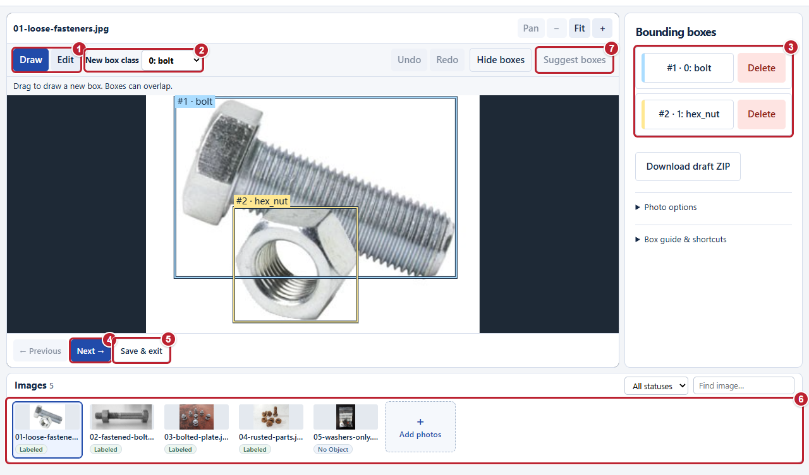

The example uses photos of loose fasteners, an assembled bolt, a bolted plate, rusted parts and a bag of washers. [Screenshot photo credits](docs/guide/photo-credits.md)

## Your first dataset

**On a phone?** Choose **Start with my photos**, select your images, then begin at step 3. See the [phone opening screen](#open-or-add-images).

1. **Start with a folder.** On your computer, create an empty folder called `My Dataset`. Open the labeler in desktop Chrome or Edge, click **Open dataset folder**, select it and allow write access if prompted.
2. **Add your photos.** Click **Create Missing Items**. The labeler creates `images/`, `labels/` and `classes.txt`. Copy your training photos into `images/`, then click **Refresh Dataset**. Keep a few fresh photos aside for testing.
3. **Choose your classes.** Click **Add Class** for each object type, enter names such as `bolt` and `hex_nut`, then click **Save Classes** and **Start Labeling**.
4. **Label each photo.** In **Draw**, choose a **New box class** and drag a tight box around each target. Use **Edit** to adjust the box. If you use [**Suggest boxes**](#get-suggestions-for-a-photo), check each suggestion, draw any missing boxes and click **Save reviewed boxes**. Then click **Next** to move on.
5. **Download your work.** Remove photos you want to leave out. To keep one with no targets, choose **Photo options → Confirm no object**. Click **Save & exit**, finish any remaining images and select **Download Labeled_data.zip** in **Review & export**.
6. **If you’re training in Colab.** Find the file in Downloads, click **I have the ZIP**, then **Continue to Training in Colab**. Upload the ZIP as-is through **Files** in your training notebook. See [Continue training in Colab](#continue-training-in-colab).

If you pause before finishing a photo or ZIP session, save a [draft ZIP](#review-save-and-resume).

[Import photos or ZIPs](#open-or-add-images) · [Classes and merging](#set-up-classes-and-combine-datasets) · [Drawing tools](#use-the-annotation-workbench) · [Phone controls](#use-the-workbench-on-a-phone) · [Saving and repairs](#review-save-and-resume) · [Export](#export-your-training-zip) · [Colab](#continue-training-in-colab) · [Help and shortcuts](#help-and-keyboard-shortcuts)

## Try the sample photos

Use these five photos to practice labeling `bolt` and `hex_nut`. Choose the workflow you want to try.

| Labeler button | Download | What to do |
|---|---|---|
| **Open a ZIP** | [Nearly finished dataset ZIP](https://active-learning-kyle.github.io/yolo-dataset-labeler/examples/fasteners/fastener-labeled-dataset.zip) | Select the downloaded ZIP as-is. Click **Label remaining photos (1)** to open the washer-only photo. To include it as a background, use **Photo options → Confirm no object**. To remove it, use **×** on its thumbnail. On desktop, hover over the thumbnail to reveal the button. |
| **Start with my photos** | [Unlabeled photos](https://active-learning-kyle.github.io/yolo-dataset-labeler/examples/fasteners/fastener-photos.zip) | Unzip the download. Select the five JPGs inside **Fastener-Photos**, using your photo library or file picker. Add `bolt` first and `hex_nut` second, click **Save Classes**, then **Start Labeling**. |

**Open dataset folder.** Create an empty folder called `My Dataset` and open it in the labeler in desktop Chrome or Edge. Select **Create Missing Items**, unzip the **Unlabeled photos** download above and copy the five JPGs into `My Dataset/images/`. Click **Refresh Dataset** and continue from step 3 of the [walkthrough](#your-first-dataset).

The washers photo contains neither target class. You can remove it from the training dataset and keep it aside to test for false detections. When every included photo has been reviewed, click **Save & exit** and download **Labeled_data.zip**. Keep the photo credits from the pack with any copy you share. [Photo sources and licenses](docs/guide/photo-credits.md)

## Open or add images

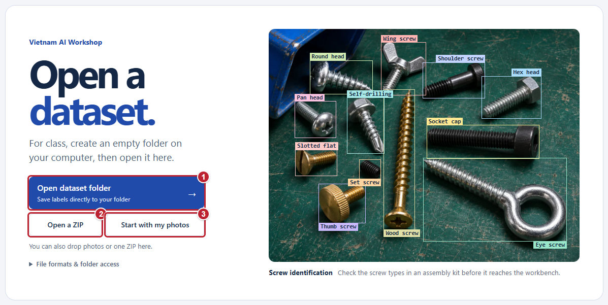

**1** Open a folder on your computer. **2** Open a ZIP or resume a draft. **3** Pick individual photos, including on a phone.

**On a phone.** Tap **1** **Start with my photos** to choose images from your device, or **2** **Open a ZIP** to open a sample or resume a draft. Both options work on phones where the browser cannot save to a folder.

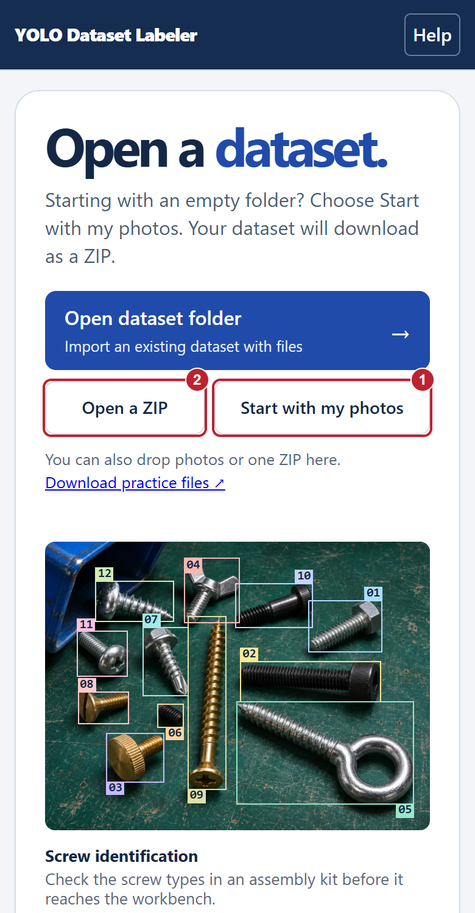

| What you have | What to do |
|---|---|
| A folder on your computer | Use **Open dataset folder**. In **Direct folder mode**, edits are written back to that folder. To add more photos, copy them into `images/`, save any class edits and click **Refresh Dataset**. |
| Individual photos | Use **Start with my photos**, or drop the photos together onto the opening screen. In setup, use **Add photos** to add another batch. |
| A ZIP of photos, a dataset or a saved draft | Use **Open a ZIP**, or drop one ZIP onto the opening screen. Existing classes and matching labels are restored when present. Drop photos and ZIPs separately. |
| A browser that only imports folders | You can import an existing dataset with files. For an empty folder, choose **Start with my photos**. In **Compatibility mode**, download a ZIP to keep your edits. |

While labeling, choose **+ Add photos** at the end of the image strip to append more photos. On a phone, open the strip with **Images** first. Use the **×** on a thumbnail to remove that photo and its label from the current dataset and future ZIP exports. Hover over the thumbnail or focus it with the keyboard to reveal the button on a computer. **Undo remove** restores the photo with its label. The original files stay on your device. If you reopen the original folder, its photos are included again. Reopen your exported ZIP to continue with the curated set.

If you remove every photo, choose **Add photos**, **Undo remove**, or **Back to dataset** to return to setup.

When you open an empty writable folder, click **Create Missing Items** where shown below. Copy photos into `images/` and click **Refresh Dataset** beside it.


Click **Help** in the top bar to find **File formats & folder access**. Supported photos are JPG/JPEG, PNG, WebP and BMP. Convert HEIC/HEIF photos to JPEG or PNG first. For ZIP imports, use UTF-8 or ASCII filenames and an unencrypted archive. Limits are 1 GiB per ZIP, 50,000 entries, 512 MiB per file and 2 GiB total extracted.

Give each photo in a writable folder a unique name before its extension. For example, `bolt-01.jpg` and `bolt-01.png` would both need `bolt-01.txt`. When you import individual photos with the same name, the labeler gives the incoming copies unique names.

## Set up classes and combine datasets

A class is an object type. Use a distinct, non-empty name for each one. The number beside each name is its ID in the label files. If `bolt` comes first and `hex_nut` second, their IDs are 0 and 1. **Save Classes** writes this order to `classes.txt`.

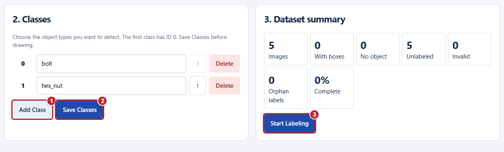

**1** Add a row for each object type. **2** Save your class names. **3** Open the workbench.

- Use **↑** to move a class up or **Delete** to remove it. The labeler disables an action if it would change or remove an ID used by existing labels, including labels on photos you can restore. You can add another class at the end.
- To open a ZIP as its own dataset, choose **Open a ZIP** on the home screen. To add labeled photos to the dataset you already have open, save your classes and choose **Import labeled ZIP** under **Dataset structure**. The class names and order must match. The labeler keeps reviewed backgrounds, skips photos without a label file and renames incoming pairs when a filename is taken.

## Use the annotation workbench

The numbers in the [workbench screenshot above](#yolo-dataset-labeler) show **1** Draw or Edit, **2** the class for the next box, **3** the list of existing boxes, **4** Next, **5** Save & exit, **6** the row of photos and **7** Suggest boxes.

| Task | How to do it |
|---|---|
| Draw overlapping objects | In **Draw**, drag from one edge of an object to the opposite corner. You can start inside an existing box. Give each visible target its own box. A box must measure at least 3 original-image pixels in both width and height. |
| Change a box | In **Edit**, click the box or select its row under **Bounding boxes**. Drag inside to move it, drag a corner to resize it, or use **Change selected box class**. The list is useful when boxes overlap. Each row also has a **Delete** button. |
| Choose the next object type | Use **New box class**. This switches to **Draw** and sets the class for the next box. Existing boxes keep their assigned classes. |
| Check a small detail | Use **+** or **−** to zoom, then **Pan** to drag the enlarged image. **Fit** restores the whole image. **Hide boxes** lets you inspect the photo underneath. Click **Show boxes** to resume working with boxes. |
| Reverse a mistake | **Undo** and **Redo** apply to the current image. You can undo a box change or an accidental background decision. |
| Find another image | Use **Previous**, **Next** or a thumbnail. Type part of a filename in **Find image…** or filter by review status. Previous and Next follow the filtered list. On narrow screens, tap **Images** to open the list. |

### Get suggestions for a photo

1. Save your classes and click **Start Labeling**, or choose **Label remaining photos** in a partly reviewed dataset. Open an unlabeled photo. Use descriptive class names such as `bolt` and `hex_nut`.
2. If you want suggestions, click **Suggest boxes** in the toolbar above the photo, beside the drawing controls. First use downloads about 155 MB of model weights. The browser processes your photos on your device. Use **Cancel** if you want to carry on by hand.
3. Check each dashed box. Choose its class in the menu beside that box under **Bounding boxes**. Use **Edit** to move or resize a box, **Delete** to remove one, and **Draw** to add any missed objects. The number marked **AI** is the model's score for its original suggestion.
4. Click **Save reviewed boxes** when the whole photo is ready. To start over, click **Discard suggestions**. If the model suggests nothing, check the photo yourself and draw boxes around any missed targets.

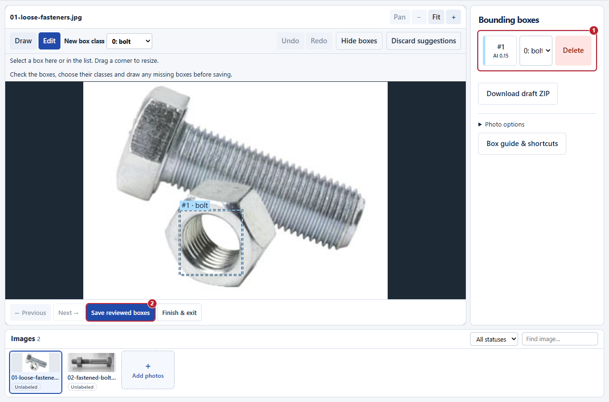

The suggestion found the bolt. Select **Draw** and the `hex_nut` class to add the missing box around the nut before saving.

The model is [OWL-ViT](https://huggingface.co/google/owlvit-base-patch32), using [quantized ONNX weights](https://huggingface.co/Xenova/owlvit-base-patch32). Fine distinctions, small parts and partly hidden objects may need more hand correction.

### Use the workbench on a phone

**Label a photo.** **1** Tap **Draw** and drag a finger across the photo to frame an object, or tap **Edit** to adjust a box. **2** Use **New box class** to choose the class for the next box. **3** Tap **Save & exit** to return to **Review & export**.

**Find another photo.** **1** Tap **Images** to open the photo list. **2** Filter by status or search by filename. **3** Swipe through the thumbnails and tap one to return to the canvas. Use **Add photos** at the end of the list to bring in more images.

<p>
  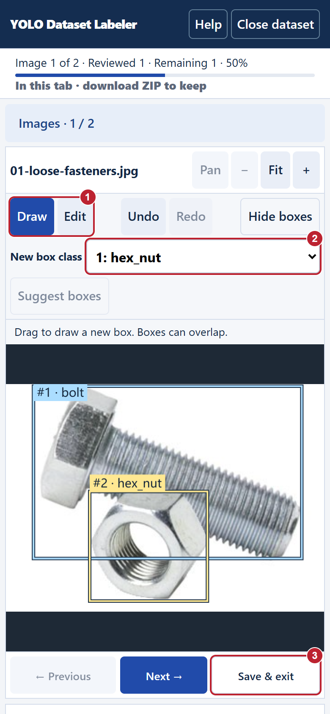
  
</p>

After zooming in, use **Pan** to move the photo with one finger, then switch back to **Draw** or **Edit**.

## Review, save and resume

In **Review & export**, choose **Start Labeling** for a fresh set. When a set is partly reviewed, **Label remaining photos** opens the first unlabeled photo and filters the list to the number shown. Choose **Review all photos** to revisit earlier work. **Review invalid files** appears when a label needs repair. **Save & exit** saves the current edits before returning here. Once the dataset is ready, **Download Labeled_data.zip** appears and **Labeling finished** shows totals per class.

When you work through the **Unlabeled** filter, photos stay in that list while you edit them. The labeler saves your edits as you go and updates their review status when you choose **Save & exit**.

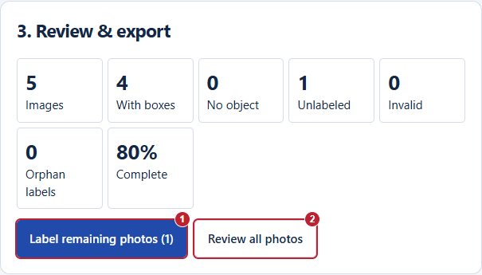

**1** Start with the remaining photos. **2** Reopen the full set for a final check.

| Status or message | What it means and what to do |
|---|---|
| **Labeled** | The photo has boxes. Check that every visible target has the right class. |
| **No Object** | Background photos are optional. To keep a photo with no targets, open **Photo options** and select **Confirm no object**. The training ZIP includes it with an empty label file. |
| **Unlabeled** | The photo still needs review. Clicking **Next** on an untouched photo leaves it in this state. |
| **Invalid** | Inspect the filename and line error. Review the boxes shown, correct or redraw them, then use **Save repaired label** when offered. Confirming replaces the invalid label with the boxes on screen. |
| **Orphan labels** or ambiguous filenames | Match each label to one image by filename stem, for example `bolt-01.jpg` and `bolt-01.txt`. Correct the source files, then refresh a writable folder or re-import the corrected dataset. |

For a blurry, duplicate or wrong photo you want to leave out, select **×** on its thumbnail.

**Folder sessions.** Look for **Saved to folder**. Reopen the same folder to resume. If **Save failed** appears, the current image stays open. Restore write access and try **Save & exit** again.

**Photo, ZIP and read-only folder sessions.** **In this tab · download ZIP to keep** means your edits are held in this tab. Choose **Download draft ZIP**, check that `Labeler-draft.zip` is in Downloads and use **Open a ZIP** next time. Unreviewed photos stay unreviewed. Use **Close dataset** to return to the opening screen after saving.

## Export your training ZIP

You can export once every image has boxes or a confirmed background and you have resolved the dataset issues. If export is blocked, check the filenames in **Review & export**.

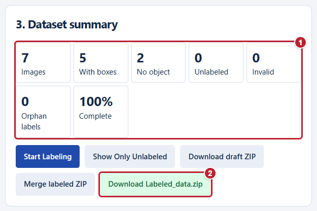

**1** Check that review is complete. **2** Download the ZIP.

**On a phone.** Scroll to **Review & export** and tap **1** **Download Labeled_data.zip**. Check your browser’s downloads or your Files app before tapping **I have the ZIP**.

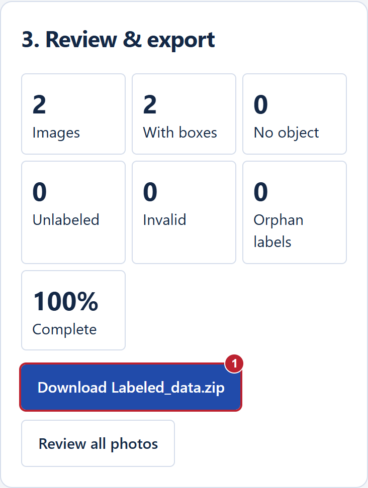

For a one-photo dataset, the ZIP contains these files.

```text
Labeled_data.zip
├── classes.txt
├── images/
│   └── bolt-01.jpg
└── labels/
    └── bolt-01.txt
```

Each box is one line in its image’s label file. The fields are `class_id x_center y_center width height`, with coordinates and dimensions expressed as fractions of the image size. The Part 5D notebook reads your class names from `classes.txt` in the saved order.

After you find `Labeled_data.zip` in Downloads, click **I have the ZIP**. This shows the image, box and background counts and the Colab link. **Return to dataset** takes you back to your work.

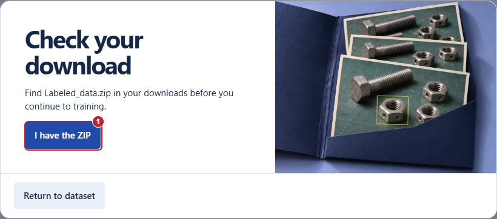

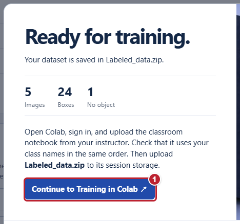

## Continue training in Colab

The regular Labeler link takes you to the Colab home page. A Labeler link with a notebook ID opens that notebook directly after you click **Continue to Training in Colab**. Sign in if prompted.

If you are using the HKU training notebook, run its cells in order.

1. Run **Check the runtime**. If Colab says it cannot connect to a GPU, choose **Connect without GPU**. A result of `Runtime ready: CPU` lets you continue.
2. In Colab’s **Files** panel, upload `Labeled_data.zip` to the top level of the session. Run **Check and split your ZIP**, then check your class names, IDs and photo counts.
3. Run **Train your detector**. Upload fresh test photos separately with filenames starting with `unseen-`, then run **Test unseen images**.
4. Run **Download your evidence** and open `team-results.zip` from Downloads. It contains your model weights, class list, training log and one prediction image per test photo. While the runtime is connected, you can also find the ZIP in Colab’s **Files** panel.

**For instructors.** Append `#notebook=YOUR_DRIVE_FILE_ID` to the Labeler URL to open your own course notebook from the training button. Use the ID after `/drive/` in its Colab link and grant your students viewer access in Google Drive.

## Help and keyboard shortcuts

Click **Help** in the top bar for a reminder about drawing, editing, marking backgrounds, minimum box size, shortcuts and saving. While labeling, expand **Box guide & shortcuts** below the bounding-box list to see a loose box and a tight box around the same hex nut.


These shortcuts work in the annotation workbench. Finish typing in a text field before using the single-key commands. Use **Ctrl** on Windows or Linux and **⌘** on macOS.

| Key | Action |
|---|---|
| `B` / `V` | Switch to Draw / Edit. |
| `1`–`9` | Choose the first through ninth class for the next box and switch to Draw. For example, `1` selects class ID 0. Use the dropdown for later classes. |
| `A` or `←` / `D` or `→` | Go to the previous / next image. |
| `Delete` or `Backspace` | Remove the selected box. |
| `Ctrl/⌘ + Z` | Undo the last change on this image. |
| `Ctrl/⌘ + Shift + Z` | Redo it. |
| `Ctrl/⌘ + S` | Download a draft ZIP. |
| `Esc` | Cancel a drag or deselect the current box. |

[MIT License](LICENSE)
