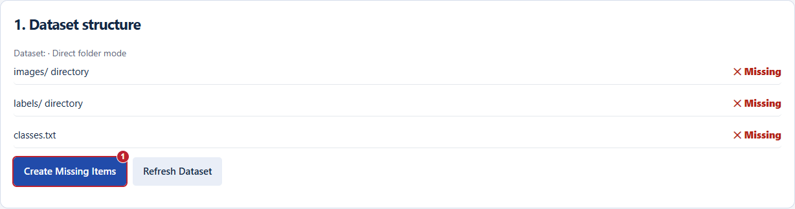
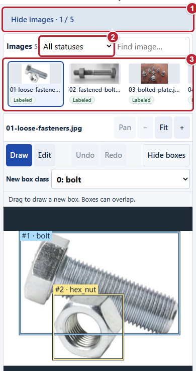
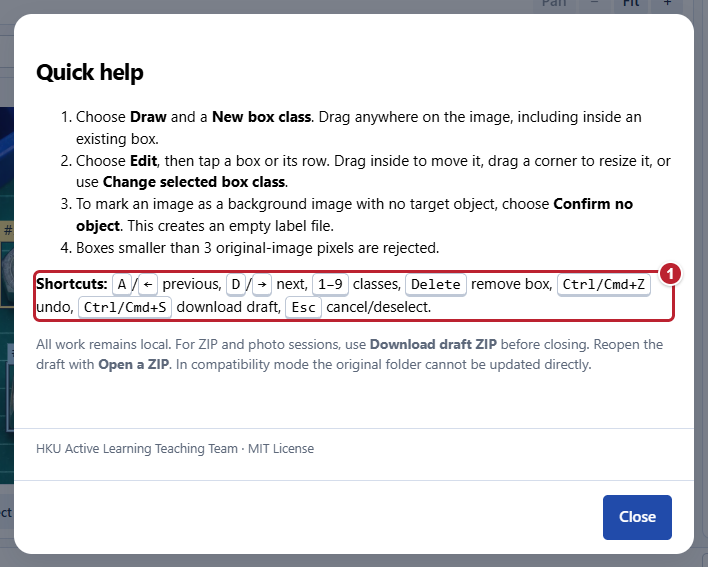

# YOLO Dataset Labeler

[Open YOLO Dataset Labeler](https://active-learning-kyle.github.io/yolo-dataset-labeler/)

**Make a YOLO dataset from your own photos.** Choose the object types you want to detect, draw a box around each one, then download a ZIP containing your photos, labels and class names. Labeling runs on your device and requires no account.


The example uses photos of loose fasteners, an assembled bolt, a bolted plate, rusted parts and a bag of washers. [Screenshot photo credits](docs/guide/photo-credits.md)

[Try the sample photos](#try-the-sample-photos) · [Start with your own photos](#your-first-dataset)

## Your first dataset

1. **Start with a folder.** On your computer, create an empty folder called `My Dataset`. Open the labeler in desktop Chrome or Edge, click **Open dataset folder**, select it and allow write access if prompted.
2. **Add your photos.** Click **Create Missing Items**. The labeler creates `images/`, `labels/` and `classes.txt`. Copy your training photos into `images/`, then click **Refresh Dataset**. Keep a few fresh photos aside for testing.
3. **Choose your classes.** Click **Add Class** for each object type, enter names such as `bolt` and `hex_nut`, then click **Save Classes** and **Start Labeling**.
4. **Label each photo.** In **Draw**, choose a **New box class** and drag a tight box around each matching object. Use **Edit** to adjust a box. Click **Next** to move on. For a photo you checked that contains none of your targets, click **Confirm no object**.
5. **Download your work.** Open **Dataset summary**, finish any remaining images and click **Download Labeled_data.zip**. The ZIP contains your photos, matching labels and class list.
6. **Continue to training.** Find the ZIP in Downloads, click **I have the ZIP**, then **Continue to Training in Colab**. In Colab, sign in and open the notebook supplied in Part 5D. Upload your `Labeled_data.zip` through the **Files** panel, leave it zipped and run the dataset check. Check your class names before training.

**On a phone?** Start at **Start with my photos**, pick your pictures and continue from step 3. Download a draft ZIP before closing if you want to finish later.

[Import photos or ZIPs](#open-or-add-images) · [Classes and merging](#set-up-classes-and-combine-datasets) · [Drawing tools](#use-the-annotation-workbench) · [Phone controls](#use-the-workbench-on-a-phone) · [Saving and repairs](#review-save-and-resume) · [Export](#export-your-training-zip) · [Help and shortcuts](#help-and-keyboard-shortcuts)

## Try the sample photos

Use these five photos to practice labeling `bolt` and `hex_nut`. Choose the workflow you want to try.

**Open dataset folder.** On your computer, create an empty folder called `My Dataset`. In desktop Chrome or Edge, choose **Open dataset folder**, select it and click **Create Missing Items**. To practice with the example photos, unzip the **Unlabeled photos** download below, copy the five JPGs into `My Dataset/images/`, then click **Refresh Dataset**. Follow steps 3–6 in the [walkthrough](#your-first-dataset).

| Labeler button | Download | What to do |
|---|---|---|
| **Open a ZIP** | [Nearly finished dataset ZIP](https://active-learning-kyle.github.io/yolo-dataset-labeler/examples/fasteners/fastener-labeled-dataset.zip) | Select the downloaded ZIP as-is. Four photos already have boxes. Click **Show Only Unlabeled** and review the washers photo, then try the final export. |
| **Start with my photos** | [Unlabeled photos](https://active-learning-kyle.github.io/yolo-dataset-labeler/examples/fasteners/fastener-photos.zip) | Unzip the download. Select the five JPGs inside **Fastener-Photos**, using your photo library or file picker. Add `bolt` first and `hex_nut` second, click **Save Classes**, then **Start Labeling**. |

The washers photo contains neither target class. Use **Confirm no object** after checking it. When every photo has been reviewed, open **Dataset summary** and download **Labeled_data.zip**. Keep the photo credits from the pack with any copy you share. [Photo sources and licenses](docs/guide/photo-credits.md)

## Open or add images


**1** Open a folder on your computer. **2** Open a ZIP or resume a draft. **3** Pick individual photos, including on a phone.

| What you have | What to do |
|---|---|
| A folder on your computer | Use **Open dataset folder**. In **Direct folder mode**, edits are written back to that folder. To add more photos, copy them into `images/`, save any class edits and click **Refresh Dataset**. |
| Individual photos | Use **Start with my photos**, or drop the photos together onto the opening screen. In setup, use **Add photos** to add another batch. |
| A ZIP of photos, a dataset or a saved draft | Use **Open a ZIP**, or drop one ZIP onto the opening screen. Existing classes and matching labels are restored when present. Drop photos and ZIPs separately. |
| A browser that only imports folders | You can import an existing dataset with files. For an empty folder, choose **Start with my photos**. In **Compatibility mode**, download a ZIP to keep your edits. |

When you open an empty writable folder, click **Create Missing Items** where shown below. Copy photos into `images/` and click **Refresh Dataset** beside it.



Open **File formats & folder access** on the opening screen for device-specific guidance. Supported photos are JPG/JPEG, PNG, WebP and BMP. Convert HEIC/HEIF photos to JPEG or PNG first. For ZIP imports, use UTF-8 or ASCII filenames and an unencrypted archive. Limits are 1 GiB per ZIP, 50,000 entries, 512 MiB per file and 2 GiB total extracted.

Give each photo in a writable folder a unique name before its extension. For example, `bolt-01.jpg` and `bolt-01.png` would both need `bolt-01.txt`. When you import individual photos with the same name, the labeler gives the incoming copies unique names.

## Set up classes and combine datasets

A class is an object type. Use a distinct, non-empty name for each one. The number beside each name is its ID in the label files. If `bolt` comes first and `hex_nut` second, their IDs are 0 and 1. **Save Classes** writes this order to `classes.txt`.


**1** Add a row for each object type. **2** Save your class names. **3** Open the workbench.

- Before labeling, use **↑** to move a class up or **Delete** to remove it. Once images have labels, the order and delete controls lock so existing IDs keep their meaning. You can still append another class.
- To combine a teammate’s work with yours, save your classes, then choose **Merge labeled ZIP** in **Dataset summary**. Both lists must have identical names in identical order. The labeler imports image–label pairs, keeps reviewed backgrounds and reports any images skipped for missing labels. If a pair’s filename is already in use, both incoming files get a matching new name.

## Use the annotation workbench

The numbers in the [workbench screenshot above](#yolo-dataset-labeler) show **1** Draw or Edit, **2** the class for the next box, **3** the list of existing boxes, **4** Next, **5** Confirm no object and **6** the row of photos.

| Task | How to do it |
|---|---|
| Draw overlapping objects | In **Draw**, drag from one edge of an object to the opposite corner. You can start inside an existing box. Give each visible target its own box. A box must measure at least 3 original-image pixels in both width and height. |
| Change a box | In **Edit**, click the box or select its row under **Bounding boxes**. Drag inside to move it, drag a corner to resize it, or use **Change selected box class**. The list is useful when boxes overlap. Each row also has a **Delete** button. |
| Choose the next object type | Use **New box class**. This switches to **Draw** and sets the class for the next box. Existing boxes keep their assigned classes. |
| Check a small detail | Use **+** or **−** to zoom, then **Pan** to drag the enlarged image. **Fit** restores the whole image. **Hide boxes** lets you inspect the photo underneath. Click **Show boxes** to resume working with boxes. |
| Reverse a mistake | **Undo** and **Redo** apply to the current image. You can undo a box change or an accidental background decision. |
| Find another image | Use **Previous**, **Next** or a thumbnail. Type part of a filename in **Find image…** or filter by review status. Previous and Next follow the filtered list. On narrow screens, tap **Images** to open the list. |

### Get suggestions for a photo

Open the optional preview if you want the labeler to propose boxes for you. [Try Suggest boxes](https://active-learning-kyle.github.io/yolo-dataset-labeler/?suggest=1)

1. Save your classes and open an unlabeled photo. To start, use desktop Chrome or Edge and descriptive class names such as `bolt` and `hex_nut`.
2. Click **Suggest boxes**. First use downloads about 155 MB of model weights. The browser processes your photos on your device. Use **Cancel** if you want to carry on by hand.
3. Check each dashed box. Choose its class in the menu beside that box under **Bounding boxes**. Use **Edit** to move or resize a box, **Delete** to remove one, and **Draw** to add any missed objects. The number marked **AI** is the model's score for its original suggestion.
4. Click **Save reviewed boxes** when the whole photo is ready. To start over, click **Discard suggestions**. If the model suggests nothing, check the photo yourself, then draw boxes or use **Confirm no object** as appropriate.

The model is [OWL-ViT](https://huggingface.co/google/owlvit-base-patch32), using [quantized ONNX weights](https://huggingface.co/Xenova/owlvit-base-patch32). Fine distinctions, small parts and partly hidden objects may need more hand correction.

### Use the workbench on a phone



**1** Tap **Images** to open the list. **2** Filter by status or search by filename. **3** Swipe along the thumbnails and tap one to return to the canvas. After zooming in, use **Pan** to move the photo with one finger, then switch back to **Draw** or **Edit**.

## Review, save and resume

**Dataset summary** shows image counts, completion and issues. Use **Show Only Unlabeled** to finish a set, or **Show Invalid Files** to inspect errors. When review is complete, **Labeling finished** shows total boxes and counts per class.

| Status or message | What it means and what to do |
|---|---|
| **Labeled** | The photo has boxes. Check that every visible target has the right class. |
| **No Object** | You reviewed the photo and selected **Confirm no object**. Its label file is empty. If it already has boxes, the app asks before replacing them. |
| **Unlabeled** | The photo still needs review. Clicking **Next** on an untouched photo leaves it in this state. |
| **Invalid** | Inspect the filename and line error. Review the boxes shown, correct or redraw them, then use **Save repaired label** when offered. Confirming replaces the invalid label with the boxes on screen. |
| **Orphan labels** or ambiguous filenames | Match each label to one image by filename stem, for example `bolt-01.jpg` and `bolt-01.txt`. Correct the source files, then refresh a writable folder or re-import the corrected dataset. |

**Folder sessions.** Look for **Saved to folder**. Reopen the same folder to resume. If **Save failed** appears, stay on the image, restore write access and try **Next** again.

**Photo, ZIP and read-only folder sessions.** **In this tab · download ZIP to keep** means your edits are held in this tab. Choose **Download draft ZIP**, check that `Labeler-draft.zip` is in Downloads and use **Open a ZIP** next time. Unreviewed photos stay unreviewed. Use **Close dataset** to return to the opening screen after saving.

## Export your training ZIP

You can export once every image has boxes or a confirmed background and you have resolved the dataset issues. If export is blocked, check the filenames in **Dataset summary**.


**1** Check that review is complete. **2** Download the ZIP.

For a one-photo dataset, the ZIP contains these files.

```text
Labeled_data.zip
├── classes.txt
├── images/
│   └── bolt-01.jpg
└── labels/
    └── bolt-01.txt
```

Each box is one line in its image’s label file. The fields are `class_id x_center y_center width height`, with coordinates and dimensions expressed as fractions of the image size. The Part 5D notebook reads your class names from `classes.txt` in the saved order.

After the final download, **I have the ZIP** reveals the image, box and background counts and the Colab link. **Return to dataset** takes you back to your work.


## Help and keyboard shortcuts

Click **Help** in the top bar for a reminder about drawing, editing, marking backgrounds, minimum box size, shortcuts and saving. While labeling, expand **Box guide & shortcuts** below the bounding-box list to see a loose box and a tight box around the same hex nut.



These shortcuts work in the annotation workbench. Finish typing in a text field before using the single-key commands. Use **Ctrl** on Windows or Linux and **⌘** on macOS.

| Key | Action |
|---|---|
| `B` / `V` | Switch to Draw / Edit. |
| `1`–`9` | Choose the first through ninth class for the next box and switch to Draw. For example, `1` selects class ID 0. Use the dropdown for later classes. |
| `A` or `←` / `D` or `→` | Go to the previous / next image. |
| `Delete` or `Backspace` | Remove the selected box. |
| `Ctrl/⌘ + Z` | Undo the last change on this image. |
| `Ctrl/⌘ + Shift + Z` | Redo it. |
| `Ctrl/⌘ + S` | Download a draft ZIP. |
| `Esc` | Cancel a drag or deselect the current box. |

[MIT License](LICENSE)
